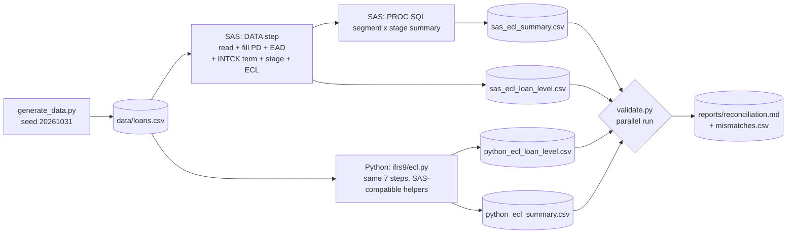

# Data lineage

## Field-level lineage

| Output field | Input fields | Transformation |
|---|---|---|
| pd_curr | pd_curr, segment | Fill missing with segment default |
| pd_source | pd_curr | Flag MODEL / DEFAULT |
| ead | balance, ccf, undrawn_limit | balance + ccf × undrawn, rounded to cents |
| term_months | maturity_date | Month boundaries from reporting date, min 1 |
| pd_lifetime | pd_curr, term_months | 1 − (1 − PD)^(years) |
| stage | days_past_due, pd_curr, pd_orig | DPD backstops + SICR (PD doubled) |
| pd_used | stage, pd_curr, pd_lifetime | Stage-dependent PD |
| ecl | pd_used, lgd, ead | PD × LGD × EAD, rounded to cents |

Step numbers match the comments in `sas/ifrs9_ecl.sas` and the functions in `ifrs9/ecl.py`.
